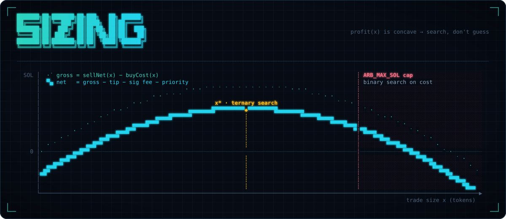
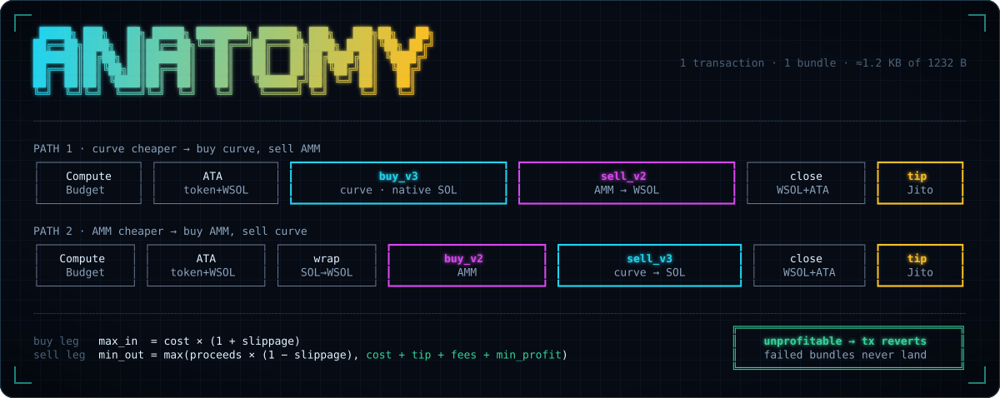

<p align="center"></p>

<p align="center">
  <a href="#quick-start"></a>
  <a href="#how-it-works"></a>
  <a href="#anatomy-of-one-arb"></a>
  <a href="#anatomy-of-one-arb"></a>
  <a href="#anatomy-of-one-arb"></a>
  <a href="#market-recorder"></a>
  <a href="LICENSE"></a>
</p>

<p align="center">
  <code>same token · two venues · two prices → buy cheap + sell dear in one atomic bundle</code>
</p>

---

## What is this

When a token trades on a **pump.fun bonding curve** and in a **PumpSwap pool** at the same time,
the two venues price it independently, and the prices drift apart. `curvegap` watches both programs
in real time, measures that gap, sizes the trade against both constant-product curves, and executes
**both legs in one v0 transaction** sent as a **Jito bundle**. Either both legs land or nothing does.

```
Path 1  (curve cheaper):  buy on bonding curve  →  sell on PumpSwap
Path 2  (AMM cheaper):    buy on PumpSwap       →  sell on bonding curve
```

> [!WARNING]
> Experimental software. Graduated tokens **cannot** be arbitraged against their old curve, and
> real opportunities are rare. Read [Reality check](#reality-check) and run the
> [market recorder](#market-recorder) before you fund a wallet.

---

## How it works

<p align="center"></p>

<details>
<summary>Same flow as text</summary>

```
 pump.fun TradeEvent            PumpSwap Buy/SellEvent
          │                              │
          └──────────┬───────────────────┘
                     ▼
 ┌───────────────────────────────────────────┐
 │ LISTEN    one WebSocket, 2× logsSubscribe  │  auto-reconnect, ping/pong
 └─────────────────────┬─────────────────────┘
                       ▼
 ┌───────────────────────────────────────────┐
 │ DISCOVER  AMM pool → its pump.fun curve    │  skip graduated / cashback /
 │           curve mint → pool lookup (gPA)   │  non-SOL; misses cached 30 min
 └─────────────────────┬─────────────────────┘
                       ▼
 ┌───────────────────────────────────────────┐
 │ PRICE     curve = vSol / vTok              │  exact BigInt
 │           AMM   = (vault + virtual) / base │  cross-multiplication
 └─────────────────────┬─────────────────────┘
                       ▼
 ┌───────────────────────────────────────────┐
 │ SIZE      on-chain fee tiers per venue     │  binary search for the cap,
 │           net of tip + tx fees             │  ternary search for the optimum
 └─────────────────────┬─────────────────────┘
                       ▼
 ┌───────────────────────────────────────────┐
 │ FIRE      re-fetch → re-size → build v0 tx │  min_out profit guard
 │           sign → Jito sendBundle           │  track realized PnL
 └───────────────────────────────────────────┘
```

</details>

### Listen

`lib/ws.mjs` opens one WebSocket with two `logsSubscribe` subscriptions:

| Program | Address | Events |
| --- | --- | --- |
| pump.fun | `6EF8rrecthR5Dkzon8Nwu78hRvfCKubJ14M5uBEwF6P` | `TradeEvent` `bddb7fd34ee661ee` |
| PumpSwap | `pAMMBay6oceH9fJKBRHGP5D4bD4sWpmSwMn52FMfXEA` | `BuyEvent` `67f4521f2cf57777`, `SellEvent` `3e2f370aa503dc2a` |

### Discover

- **AMM → curve.** Every unknown pool seen in a swap event is fetched. If its base mint has a pump.fun
  bonding curve that is SOL-paired, still active and not a cashback coin, the token becomes a
  tracked pair.
- **Curve → AMM.** Unknown mints from curve trades are queued for a pool lookup: first the canonical
  pool PDA, then `getProgramAccounts` filtered by `base_mint` + WSOL (this catches permissionless
  pools). Lookups are rate-limited (`ARB_DISCOVERY_RPS`) and misses are cached for 30 minutes.

### Price

```
priceCurve = virtualSolReserves / virtualTokenReserves
priceAMM   = (quoteVault + Pool.virtual_quote_reserves) / baseVault
spread     = |priceAMM − priceCurve| / min(priceAMM, priceCurve)
```

`virtual_quote_reserves` is a signed `i128` on the pool account and can be negative. Every tracked
pair is refreshed every `ARB_SCAN_INTERVAL_MS` with one batched `getMultipleAccountsInfo` (curve,
pool, both vaults). It is also refreshed right away (debounced 150 ms) whenever either venue trades it.

### Size

<p align="center"></p>

```
CURVE_TO_AMM:  profit(x) = ammSellNet(x)   − curveBuyCost(x)
AMM_TO_CURVE:  profit(x) = curveSellNet(x) − ammBuyCost(x)
net            = profit(x) − jitoTip − signatureFee − priorityFee
```

Fees come from the **Pump Fees** program (`pfeeUxB6jkeY1Hxd7CsFCAjcbHA9rWtchMGdZ6VojVZ`):

- Bonding curves and canonical pools use market-cap tiers.
- Permissionless pools use flat fees.

Each fee component is rounded up separately, the same way the programs do it. Both venues are
constant-product, so `profit(x)` is concave. The bot binary-searches for the largest `x` that fits
under `ARB_MAX_SOL`, then ternary-searches for the optimum. The curve buy is capped at
`realTokenReserves`.

### Fire

`bot/executor.mjs` re-fetches every account, re-checks the spread and re-sizes the trade just
before it builds the transaction.

## Anatomy of one arb

<p align="center"></p>

| Path | Instructions |
| --- | --- |
| Curve → AMM | ComputeBudget · create token ATA · create WSOL ATA · `buy_v3` (native SOL) · `sell_v2` (→ WSOL) · close WSOL · close token ATA · Jito tip |
| AMM → Curve | ComputeBudget · create token ATA · create WSOL ATA · wrap SOL · `buy_v2` · `sell_v3` (→ native SOL) · close WSOL · close token ATA · Jito tip |

- **Buy leg:** `max_in = cost × (1 + ARB_MAX_SLIPPAGE)`
- **Sell leg:** `min_out = max(proceeds × (1 − ARB_MAX_SLIPPAGE), cost + tip + fees + ARB_MIN_PROFIT)`.
  If the quote is stale, the transaction reverts instead of losing money.
- The token ATA is closed at the end and its rent refunded, unless it already existed.
- The transaction is about 1.2 KB, under the 1232 B limit. With the optional lookup table
  (`npm run alt:create`) it is about 820 B.
- It is sent with `sendBundle` (base58) to `POST {JITO_BLOCK_ENGINE_URL}/api/v1/bundles`. The bot
  then follows the signature and records realized PnL from the fee payer's balance change.

## Market recorder

Before risking SOL, find out whether the market has any gaps at all. The recorder runs the scanner
for hours or days and logs everything it sees to disk. It never trades and needs no wallet.

<p align="center"></p>

```bash
npm run record -- --duration 6h            # or 30m, 2d; omit to run until Ctrl+C
npm run report -- logs/scan-2026-11-08T14-35-57
```

Each run writes its own directory under `logs/`:

| File | Contents |
| --- | --- |
| `pairs.jsonl` | every token found live on both venues (canonical or permissionless pool, curve SOL) |
| `spreads.jsonl` | spread samples ≥ `ARB_MIN_SPREAD`: prices, liquidity on each side, optimal size, net PnL |
| `opportunities.jsonl` | one line per **episode**: a run of back-to-back profitable evaluations for one mint (start, duration, max spread, max net, size) |
| `stats.jsonl` | counter snapshot every 60 s |
| `summary.json` | totals, a histogram of tradable spreads, episodes per hour, the top 20 pairs. Rewritten every 60 s, so it survives a crash |

`Theoretical PnL` adds up the best moment of every episode. It is an **upper bound** that assumes
no competition and perfect timing. If that number is near zero after a day, live trading will not
make money either.

Options: `--out <dir>` (default `logs`) and `--include-graduated`.

## Quick start

```bash
git clone https://github.com/zostaff/curvegap.git
cd curvegap
npm install
cp .env.example .env          # fill in RPC_URL / RPC_WSS (+ WALLET_PRIVATE_KEY for trading)

npm run record -- --duration 6h   # 1. measure the market (no wallet needed)
npm run dry-run                   # 2. watch spreads live, never trade
npm run alt:create                # 3. optional: lookup table → ARB_LOOKUP_TABLE
npm run simulate                  # 4. build + RPC-simulate every arb tx
npm start                         # 5. LIVE trading
```

Need a fresh wallet? `npm run wallet:new` prints a new keypair.

### Commands

| Command | Description |
| --- | --- |
| `npm start` | Live bot: monitor, size and send Jito bundles |
| `npm run dry-run` | Scan spreads and log opportunities, never trade |
| `npm run simulate` | Dry run that also builds, signs and RPC-simulates each arb tx |
| `node bot/arbitrage.mjs --simulate` | Live, but simulate before every send and skip failures |
| `npm run scan` | Standalone scanner with prices on both venues (`--include-graduated`) |
| `npm run record` | Long-running market recorder (`--duration`, `--out`) |
| `npm run report -- <dir>` | Print the summary of a recording |
| `npm run alt:create` | Create (or extend) the Address Lookup Table |
| `npm run wallet:new` | Generate a new keypair |

Add `--verbose` to any bot command for debug logs.

## Configuration

All settings live in `.env` (see [`.env.example`](.env.example)).

| Variable | Default | Description |
| --- | --- | --- |
| `RPC_URL` | — | HTTP RPC endpoint |
| `RPC_WSS` | derived from `RPC_URL` | WebSocket endpoint |
| `HELIUS_API_KEY` | — | Used to build `RPC_URL` if it is not set |
| `WALLET_PRIVATE_KEY` | — | base58 secret key, JSON byte array, or path to a keypair file |
| `JITO_BLOCK_ENGINE_URL` | `https://mainnet.block-engine.jito.wtf` | Block engine (use a regional one close to you) |
| `ARB_LOOKUP_TABLE` | — | Address Lookup Table created by `npm run alt:create` |
| `ARB_MIN_SPREAD` | `0.02` | Minimum spread to consider (2%) |
| `ARB_MAX_SOL` | `0.5` | Max SOL per arbitrage |
| `ARB_JITO_TIP` | `0.001` | Jito tip per bundle (SOL) |
| `ARB_MIN_LIQUIDITY` | `1.0` | Min SOL liquidity on each venue |
| `ARB_MAX_SLIPPAGE` | `0.03` | Max slippage per leg (3%) |
| `ARB_COOLDOWN_SEC` | `3` | Pause between arbs on the same token |
| `ARB_SCAN_INTERVAL_MS` | `2000` | Full price refresh interval |
| `ARB_MIN_PROFIT` | `0.0005` | Minimum net profit after all costs (SOL) |
| `ARB_PRIORITY_MICROLAMPORTS` | `0` | Compute unit price (the Jito tip already buys inclusion) |
| `ARB_COMPUTE_UNITS` | `400000` | Compute unit limit |
| `ARB_CURVE_FEE_BPS` | on-chain | Override the pump.fun total fee (bps) |
| `ARB_AMM_FEE_BPS` | on-chain | Override the PumpSwap total fee (bps) |
| `ARB_MAX_PAIRS` | `500` | Max tracked dual-venue tokens (LRU eviction) |
| `ARB_DISCOVERY_RPS` | `2` | Max `getProgramAccounts` pool lookups per second |

## Project layout

```
lib/
  config.mjs      .env loading, CLI flags, defaults (amounts converted to lamports / bps)
  constants.mjs   program IDs, discriminators, account and event layouts, Jito tip accounts
  fees.mjs        Pump Fees config decoding, market-cap fee tiers, per-component fee rounding
  pumpfun.mjs     bonding curve: PDAs, state, buy_v3 / sell_v3, quotes, TradeEvent parsing
  pumpswap.mjs    PumpSwap: pool discovery, effective reserves, buy_v2 / sell_v2, quotes, events
  rpc.mjs         Connection, batched account fetch, blockhash cache, send / simulate / confirm
  tx.mjs          v0 transaction builder, ComputeBudget, lookup table helpers
  wallet.mjs      keypair load / generate
  ws.mjs          WebSocket logs stream with reconnect
  jito.mjs        Jito bundle API and tip instruction
  log.mjs         colors and formatting
bot/
  arbitrage.mjs   main bot: monitoring + arbitrage + session stats
  scanner.mjs     dual-venue discovery, spreads, optimal sizing (also runnable standalone)
  executor.mjs    builds, simulates and sends the atomic arb transaction
  recorder.mjs    long-running market statistics → JSONL + summary
  setup-alt.mjs   creates the Address Lookup Table with all static accounts
docs/img/         README graphics
```

## Reality check

- **Graduated tokens cannot be arbitraged against their old curve.** When a token graduates,
  pump.fun sets `complete = true`, zeroes the curve's reserves and moves the liquidity to the
  canonical PumpSwap pool. After that the curve rejects every buy and sell, so the bot skips
  graduated curves. The real opportunities are tokens whose curve is **still active** while
  someone has created a **permissionless PumpSwap pool** for the same mint. These are rare.
- **Competition.** Any gap that does appear is contested by other searchers. Tune `ARB_JITO_TIP`,
  use a low-latency RPC and a nearby regional block engine.
- **Protocol churn.** pump.fun and PumpSwap are upgraded often: new accounts, fee changes, new
  instruction versions. Layouts here follow the official
  [pump-public-docs](https://github.com/pump-fun/pump-public-docs) IDLs as of November 2026.
  After every protocol upgrade, run `npm run simulate` before trading live.
- **Cashback coins** reject `buy_v3` / `sell_v3` / `buy_v2` / `sell_v2` and are skipped.
- **Leg risk is limited, not zero.** Failed bundles don't land and cost nothing, and the profit
  guard reverts unprofitable executions. But the guard assumes the buy leg cost what was quoted.
  If the cheap venue moved within `ARB_MAX_SLIPPAGE` before your bundle landed, profit can be
  lower than quoted.
- Closing the WSOL ATA at the end of each arb also unwraps any WSOL you already held in it.

<details>
<summary>Notes on the original specification</summary>

Some values in the original specification differ from what is on-chain today. The bot uses the
on-chain values:

- `CebN5WGQ4jvEPvsVU4EoHEpgzq1VV7AbCJ5tGLDMDSRp` is not a valid fee recipient. The real one is
  `CebN5WGQ4jvEPvsVU4EoHEpgzq1VV7AbicfhtW4xC9iM`, and v3/v2 trades no longer take a fee recipient.
- `62qc2CNXwrYqQScmEdiZFFAnJR262PxWEuNQtxfafNgV` is `Global.fee_recipient`, not the fee config.
  The pump.fun fee config is the PDA `8Wf5TiAheLUqBrKXeYg2JtAFFMWtKdG2BSFgqUcPVwTt`.
- `d78f037c39e9b3b6` does not match any pump.fun instruction. The legacy `buy` is
  `66063d1201daebea` and the legacy `sell` is `33e685a4017f83ad`; the bot uses `buy_v3` / `sell_v3`.
- `3e2f370aa503dc2a` is PumpSwap's `SellEvent` discriminator, not a fee event.
- The pump.fun fee is a market-cap tier (currently 0.95% protocol + 0.30% creator), not a flat 1%.

</details>

## Disclaimer

This software is provided as is, for research and educational purposes. Trading on-chain is risky
and you can lose funds. You alone are responsible for how you use it.

## License

[MIT](LICENSE) © zostaff
