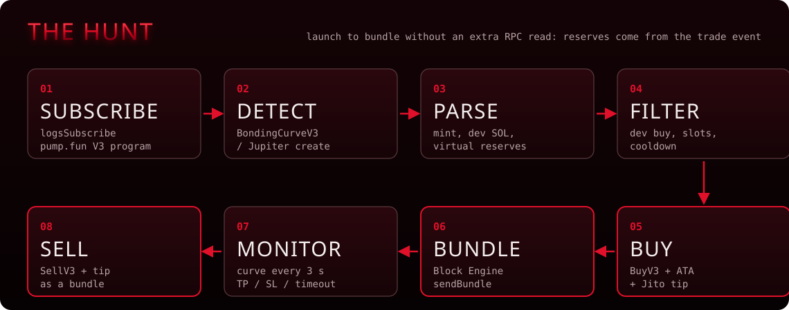
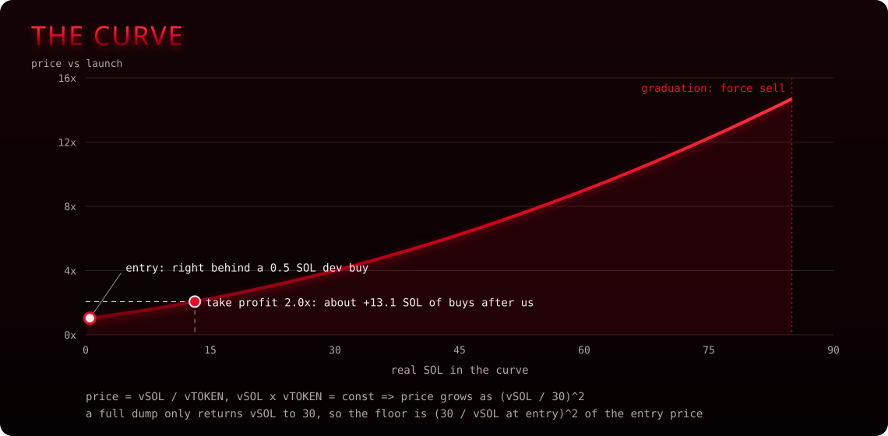
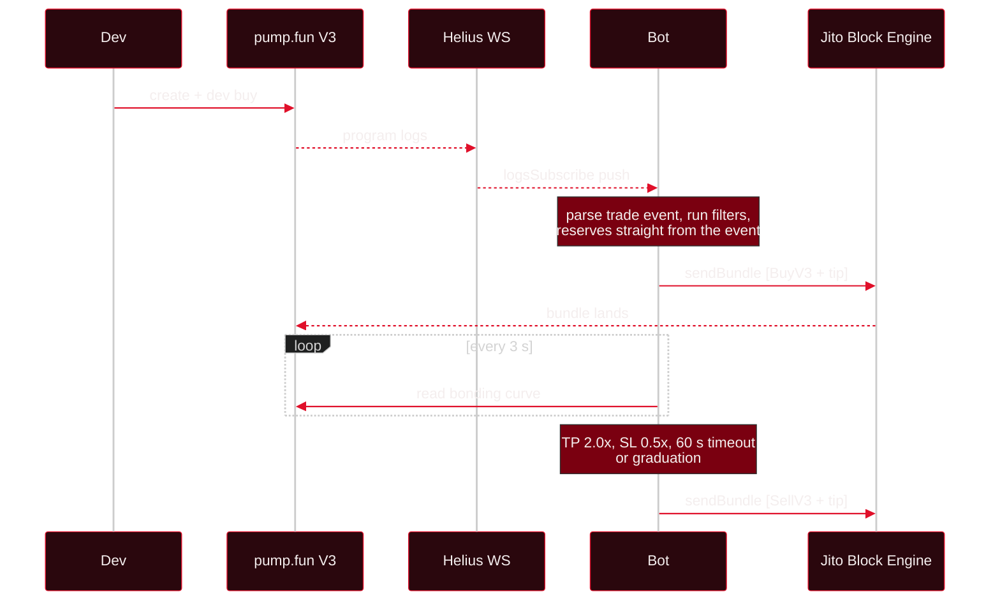
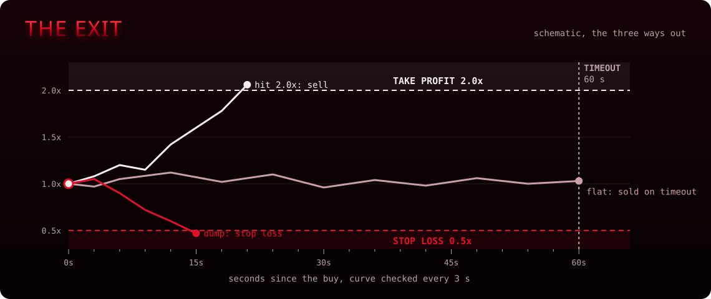
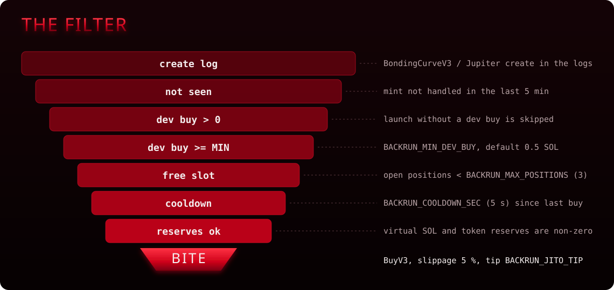
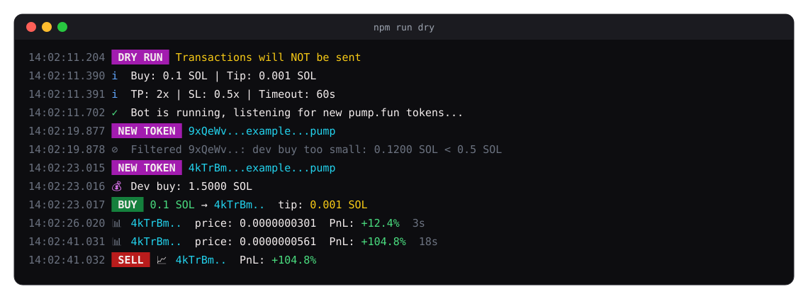
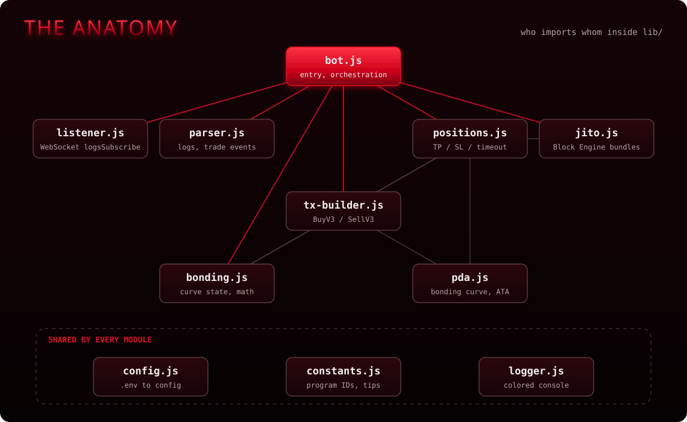

<p align="center"></p>

<p align="center">
  <a href="#quick-start"></a>
  <a href="#stack"></a>
  <a href="#v3-event-parsing"></a>
  <a href="#jito-bundle-flow"></a>
  <a href="#dry-run"></a>
  <a href="LICENSE"></a>
</p>

<p align="center">
  <code>detect new pump.fun tokens → backrun with jito bundle → same block entry</code>
</p>

---

## What is this

A Solana bot that watches pump.fun V3 for new token launches in real-time and sends a buy transaction as a Jito bundle to land in the same block as the token creation.

Traditional bots send transactions through RPC and hope they land. Firstblood sends through Jito Block Engine as a bundle, which means your buy is included by the validator as a unit: either the whole bundle lands or nothing does. No partial fills, no wasted fees on failed txs.

<p align="center"></p>

<details>
<summary>Same flow as text</summary>

```
 new token created on pump.fun
              │
              ▼
 ┌─────────────────────────┐
 │  WebSocket logsSubscribe │  ← real-time pump.fun V3 logs
 └────────────┬────────────┘
              │
              ▼
 ┌─────────────────────────┐
 │  Parse V3 trade event    │  ← mint, sol amount, reserves
 │  Classify instruction    │  ← BondingCurveV3 = new token
 └────────────┬────────────┘
              │
              ▼
 ┌─────────────────────────┐
 │  Filters                 │  ← dev buy ≥ 0.5 SOL?
 │  • min dev buy           │  ← reserves valid?
 │  • reserve sanity        │  ← under max positions?
 │  • position limits       │  ← cooldown passed?
 │  • cooldown              │
 └────────────┬────────────┘
              │ passed
              ▼
 ┌─────────────────────────┐
 │  Build buy transaction   │  ← createATA + buyV3 + jito tip
 │  Sign + serialize        │  ← VersionedTransaction v0
 └────────────┬────────────┘
              │
              ▼
 ┌─────────────────────────┐
 │  Jito Block Engine       │  ← POST /api/v1/bundles
 │  sendBundle([base58_tx]) │  ← 1 retry on failure
 └────────────┬────────────┘
              │
              ▼
 ┌─────────────────────────┐
 │  Position monitor        │  ← polls price every 3s
 │  Exit on TP / SL / time  │  ← sells via Jito bundle
 └─────────────────────────┘
```

</details>

---

## Why Jito Bundles

Regular transaction flow:
```
you → RPC → mempool → validator picks it up (maybe) → lands (maybe)
```

Jito bundle flow:
```
you → Jito Block Engine → validator runs your bundle atomically → lands (or refunded)
```

| | Regular TX | Jito Bundle |
|-|-----------|-------------|
| Landing guarantee | No: can be dropped | Atomic: all or nothing |
| Speed | 1-5 seconds | Same block as trigger |
| Failed tx cost | You pay fees anyway | No landing = no fees |
| MEV protection | Exposed to frontrunners | Bundle is private until execution |
| Tip | Priority fee to validator | Jito tip to validator via tip account |

The tip is a plain SOL transfer to one of 8 Jito-designated tip accounts, added as the last instruction in the transaction. Each bundle picks a random tip account to distribute load.

---

## V3 Event Parsing

pump.fun silently migrated to V3. Old V2 prefixes are dead. This bot uses the current V3 format:

```
 V3 Trade Event Layout (390-391 bytes)
 ──────────────────────────────────────

 Offset   Size   Field
 0        8      Discriminator    bddb7fd34ee661ee
 8        32     Mint             token address (Pubkey)
 40       8      SOL amount       lamports (u64 LE)
 48       8      Token amount     raw units (u64 LE)
 56       1      (reserved)       flag byte
 57       32     User             buyer/seller pubkey
 89       8      (reserved)       extended field
 97       8      Virtual SOL      reserves after trade (u64 LE)
 105      8      Virtual Token    reserves after trade (u64 LE)
 113+     278    Extended data    fees, holder info, padding
```

### How creates are detected

V3 has no separate "create" event. Token creation is detected by the **instruction name** in `Program log:` lines:

```
Program log: Instruction: BondingCurveV3       → new token + dev buy
Program log: Instruction: BondingCurveJupiter  → new token via Jupiter + dev buy
```

The `BondingCurveV3` instruction creates the bonding curve AND executes the dev's initial buy atomically. The trade event emitted from it contains the dev buy amount and post-buy reserves, which is exactly what we need to calculate our entry.

### How buys and sells are classified

Subsequent trades are classified by instruction name:

```
Buy / BuyV2 / BuyV3 / BuyExactQuoteInV3 / BuyExactSolIn  →  buy
Sell / SellV2 / SellV3                                    →  sell
```

The bot only acts on create events. It ignores subsequent buy/sell events from other users.

### Key insight: zero-RPC backrun

The trade event's `virtualSolReserves` and `virtualTokenReserves` fields reflect the state **after** the dev buy. This means we can calculate our buy output directly from the event data without an extra `getAccountInfo` RPC call, saving ~100-200ms of latency per opportunity.

---

## Bonding Curve Math

pump.fun uses a constant-product bonding curve (similar to Uniswap x*y=k). All calculations use BigInt to avoid floating-point precision issues.

```
price = virtualSolReserves / virtualTokenReserves

buy:
  tokensOut = (solIn × virtualTokenReserves) / (virtualSolReserves + solIn)

sell:
  solOut = (tokensIn × virtualSolReserves) / (virtualTokenReserves + tokensIn)
```

<p align="center"></p>

> [!NOTE]
> The chart uses the classic launch reserves of 30 virtual SOL. Price grows with the square of the SOL in the curve, so a 2.0x take profit after a 0.5 SOL dev buy needs roughly 13 SOL of buys landing after you. A full dump can only push vSOL back to 30, so right after a small dev buy the floor sits just under the entry and a 0.5x stop loss is rarely reachable: those positions close on the timeout.

### Slippage protection

Buy transactions include a `minTokensOut` field: the minimum tokens you'll accept. If the price moves against you between event detection and bundle landing, the transaction reverts instead of executing at a bad price.

```
minTokensOut = expectedTokens × (1 - slippageBps / 10000)
```

Default slippage: **5% on buy** (500 bps), **10% on sell** (1000 bps). Sell has higher slippage because exit timing matters more than entry precision.

### Graduation

When `virtualSolReserves` reaches ~85 SOL, the bonding curve "graduates" and liquidity migrates to PumpSwap AMM (`pAMMBay6oceH9fJKBRHGP5D4bD4sWpmSwMn52FMfXEA`). The bot detects this by checking the `complete` flag in the bonding curve account and force-sells before migration.

---

## Program Addresses

```
pump.fun V3 Program     6EF8rrecthR5Dkzon8Nwu78hRvfCKubJ14M5uBEwF6P
Global Account           4wTV1YmiEkRvAtNtsSGPtUrqRYQMe5SKy2uB4Jjaxnjf
Fee Recipient            CebN5WGQ4jvEPvsVU4EoHEpgzq1VV7AbCJ5tGLDMDSRp
Event Authority          Ce6TQqeHC9p8KetsN6JsjHK7UTZk7nasjjnr7XxXp9F1
Fee Config               62qc2CNXwrYqQScmEdiZFFAnJR262PxWEuNQtxfafNgV
PumpSwap AMM             pAMMBay6oceH9fJKBRHGP5D4bD4sWpmSwMn52FMfXEA
```

### PDA derivation

Bonding curve address for a given mint:
```
seeds = ["bonding-curve", mint.toBytes()]
program = 6EF8rrecthR5Dkzon8Nwu78hRvfCKubJ14M5uBEwF6P
```

---

## Transaction Construction

### Buy transaction: 5 instructions

```
 Instruction                    Purpose
 ────────────────────────────── ──────────────────────────────────
 1. SetComputeUnitLimit         200,000 CU (V3 buy + ATA creation)
 2. SetComputeUnitPrice         100,000 microLamports per CU
 3. CreateAssociatedTokenAcct   idempotent: safe if ATA exists
 4. BuyV3                       pump.fun buy instruction
 5. SystemProgram.transfer      Jito tip to random tip account
```

### BuyV3 instruction data

```
 Offset   Size   Field
 0        8      Discriminator    07051dc4f5176550
 8        8      minTokensOut     u64 LE: minimum tokens to accept
 16       8      maxSolIn         u64 LE: maximum SOL to spend
```

### BuyV3 accounts (13)

```
 #   Account               Signer   Writable   Source
 ──  ────────────────────── ──────── ────────── ──────────────────
  0  PUMP_GLOBAL            no       no         constant
  1  PUMP_FEE_RECIPIENT     no       yes        constant
  2  mint                   no       no         from event
  3  bondingCurve           no       yes        PDA from mint
  4  bondingCurveATA        no       yes        ATA of bonding curve
  5  buyerATA               no       yes        ATA of buyer
  6  buyer                  yes      yes        your wallet
  7  SYSTEM_PROGRAM         no       no         11111...
  8  TOKEN_PROGRAM          no       no         TokenkegQ...
  9  RENT_PROGRAM           no       no         SysvarRent...
 10  PUMP_EVENT_AUTHORITY   no       no         constant
 11  PUMP_PROGRAM           no       no         self-CPI reference
 12  PUMP_FEE_CONFIG        no       no         constant
```

### SellV3 instruction data

```
 Offset   Size   Field
 0        8      Discriminator    1c92de7726c469d5
 8        8      tokenAmount      u64 LE: tokens to sell
 16       8      minSolOut        u64 LE: minimum SOL to receive
```

### Why VersionedTransaction v0

Legacy transactions have a 1232-byte limit and use direct account addresses. V0 messages support address lookup tables and have better compatibility with Jito validators. Even without lookup tables, v0 is preferred because:
- Jito validators optimize for v0 processing
- Future upgrade path to use lookup tables for smaller tx size
- Signals to the runtime that this is a modern client

---

## Jito Bundle Flow

```
1. Build VersionedTransaction v0
2. Sign with wallet Keypair
3. Serialize to Uint8Array
4. Encode as base58
5. POST to Jito Block Engine:

   POST https://mainnet.block-engine.jito.wtf/api/v1/bundles
   {
     "jsonrpc": "2.0",
     "id": 1,
     "method": "sendBundle",
     "params": [["<base58_signed_tx>"]]
   }

6. Receive bundle ID
7. On failure: 1 automatic retry with same tip (no escalation)
8. 5-second timeout per request
```



### Tip accounts

Each bundle randomly selects one:
```
96gYZGLnJYVFmbjzopPSU6QiEV5fGqZNyN9nmNhvrZU5
HFqU5x63VTqvQss8hp11i4wVV8bD44PvwucfZ2bU7gRe
Cw8CFyM9FkoMi7K7Crf6HNQqf4uEMzpKw6QNghXLvLkY
ADaUMid9yfUytqMBgopwjb2DTLSokTSzL1zt6iGPaS49
DfXygSm4jCyNCybVYYK6DwvWqjKee8pbDmJGcLWNDXjh
ADuUkR4vqLUMWXxW9gh6D6L8pMSawimctcNZ5pGwDcEt
DttWaMuVvTiduZRnguLF7jNxTgiMBZ1hyAumKUiL2KRL
3AVi9Tg9Uo68tJfuvoKvqKNWKkC5wPdSSdeBnizKZ6jT
```

### Error handling

| Error | Action |
|-------|--------|
| HTTP non-200 | Log status + statusText, retry once |
| JSON-RPC error | Log code + message, retry once |
| Request timeout (5s) | Log "request timeout", retry once |
| Second failure | Return null, log error, skip opportunity |

---

## Position Management

After a successful buy, the bot monitors the position:

```
 ┌─────────────────────────────────────┐
 │  Position: DYdfB51G...              │
 │  Entry:    0.000013566 SOL/token    │
 │  Amount:   7,235,110 tokens         │
 │  Cost:     0.1 SOL + 0.001 tip      │
 │                                     │
 │  Current:  0.000025 SOL/token       │
 │  PnL:      +84.2%                   │
 │  Time:     12s                      │
 │                                     │
 │  TP: 2.0x (sell)  SL: 0.5x (sell)   │
 │  Timeout: 60s (force sell)          │
 └─────────────────────────────────────┘
```

### Exit rules

<p align="center"></p>

| Trigger | Condition | Action |
|---------|-----------|--------|
| Take Profit | `pnl >= (TP - 1)` → price doubled at TP=2.0 | Sell via Jito bundle |
| Stop Loss | `pnl <= -(1 - SL)` → -50% at SL=0.5 | Sell via Jito bundle |
| Timeout | Position age > `TIMEOUT_SEC` | Force sell via Jito bundle |
| Graduation | Bonding curve `complete` flag = true | Force sell before AMM migration |

### RPC rate limiting

Position monitoring fetches bonding curve state via `getAccountInfo`. To avoid burning through RPC credits:
- 200ms delay between each position check
- Guard flag prevents overlapping check cycles
- At 3 max positions: ~15 RPC calls per check cycle, ~5 cycles per minute = ~75 req/min

---

## Filtering Logic

The bot runs these filters in order. Each one can skip the opportunity:

<p align="center"></p>

```
 ┌─────────────────────────────┐
 │ 1. Is this a create event?   │  classifyLogMessages → isCreate
 │    no → skip                 │
 ├─────────────────────────────┤
 │ 2. Has trade event data?     │  extractTradeEventsFromLogs
 │    no → skip                 │
 ├─────────────────────────────┤
 │ 3. Already seen this mint?   │  seenMints Map (5min TTL)
 │    yes → skip                │
 ├─────────────────────────────┤
 │ 4. Dev buy > 0 SOL?          │  event.solAmount > 0
 │    no → skip                 │
 ├─────────────────────────────┤
 │ 5. Dev buy ≥ MIN_DEV_BUY?    │  event.solAmount ≥ 0.5 SOL
 │    no → skip (too small)     │
 ├─────────────────────────────┤
 │ 6. Under MAX_POSITIONS?      │  positions.activeCount < 3
 │    no → skip (full)          │
 ├─────────────────────────────┤
 │ 7. Cooldown passed?          │  now - lastBuy ≥ 5s
 │    no → skip (too fast)      │
 ├─────────────────────────────┤
 │ 8. Valid reserves?            │  vSol > 0 && vTok > 0
 │    no → skip (bad data)      │
 ├─────────────────────────────┤
 │ ✓ All passed → BUY           │
 └─────────────────────────────┘
```

### Why min dev buy matters

Tokens where the dev bought less than 0.5 SOL are often low-effort scams with no real interest behind them. The dev buy size is a simple signal: if the creator has skin in the game, the token is more likely to attract buyers. This is not a guarantee: it's just a first filter.

---

## Quick Start

```bash
git clone https://github.com/zostaff/firstblood.git
cd firstblood
npm install
cp .env.example .env
```

Edit `.env`:
```env
RPC_WSS=wss://mainnet.helius-rpc.com/?api-key=YOUR_KEY
RPC_URL=https://mainnet.helius-rpc.com/?api-key=YOUR_KEY
HELIUS_API_KEY=YOUR_KEY
WALLET_PRIVATE_KEY=your_base58_private_key
```

Run:
```bash
# paper trading (no real transactions)
npm run dry

# live trading
npm start
```

### Getting a Helius API key

1. Go to [helius.dev](https://helius.dev)
2. Sign up and create a project
3. Copy your API key
4. The free tier includes WebSocket support and enough credits to run the bot

### Wallet setup

Export your wallet's private key as a base58 string. Most wallets (Phantom, Solflare) let you export this from settings. **Never share your private key. Never commit `.env` to git.**

If you just want to observe:
```bash
# dry-run doesn't need a real wallet
npm run dry
```

---

## Configuration

| Variable | Default | What it does |
|----------|---------|-------------|
| `RPC_WSS` | - | Helius WebSocket endpoint for log subscriptions |
| `RPC_URL` | - | Helius HTTP endpoint for RPC calls |
| `HELIUS_API_KEY` | - | Helius API key |
| `WALLET_PRIVATE_KEY` | - | Base58 private key (not needed for --dry-run) |
| `BACKRUN_BUY_SOL` | `0.1` | SOL to spend per buy |
| `BACKRUN_JITO_TIP` | `0.001` | SOL tip per Jito bundle |
| `BACKRUN_TAKE_PROFIT` | `2.0` | Sell at 2x entry price |
| `BACKRUN_STOP_LOSS` | `0.5` | Sell at 0.5x entry price (-50%) |
| `BACKRUN_TIMEOUT_SEC` | `60` | Force sell after N seconds |
| `BACKRUN_MIN_DEV_BUY` | `0.5` | Skip tokens where dev bought less |
| `BACKRUN_MAX_POSITIONS` | `3` | Max concurrent open positions |
| `BACKRUN_COOLDOWN_SEC` | `5` | Min seconds between buys |
| `JITO_BLOCK_ENGINE` | `https://mainnet.block-engine.jito.wtf` | Jito endpoint |

### Tuning tips

- **More aggressive**: Lower `MIN_DEV_BUY` to 0.1, increase `MAX_POSITIONS` to 5, lower `COOLDOWN_SEC` to 2
- **More conservative**: Raise `MIN_DEV_BUY` to 1.0, set `TAKE_PROFIT` to 1.5, set `TIMEOUT_SEC` to 30
- **Tip sizing**: 0.001 SOL is competitive for most slots. Raise to 0.005 in high-activity periods
- **Buy sizing**: Start small (0.01 SOL) until you're confident in the filtering

---

## Dry Run

```bash
node bot.js --dry-run
```

<p align="center"></p>
<p align="center"><sub>example output, mints are placeholders</sub></p>

In dry-run mode:
- Generates an ephemeral wallet (no real keys needed)
- Detects tokens and runs all filters on live data
- Logs what it WOULD buy/sell with exact amounts
- Tracks virtual positions with real price data from on-chain
- Calculates and reports PnL as if trades were real
- Stats summary every 30 seconds and at shutdown

Use this to:
1. Validate your filter settings produce reasonable hit rates
2. Understand the flow before risking real SOL
3. Estimate what your PnL would look like with current config
4. Check that your RPC connection is stable

---

## Architecture

<p align="center"></p>

```
bot.js                 entry point, orchestration, SIGINT handler
│
├── lib/listener.js    WebSocket logsSubscribe + auto-reconnect
│                      exponential backoff (1s → 30s max)
│
├── lib/parser.js      V3 trade event parsing (bddb7fd34ee661ee prefix)
│                      instruction name classification (create/buy/sell)
│
├── lib/bonding.js     on-chain bonding curve account deserialization
│                      constant-product math (BigInt, no floats)
│                      tokensOut / solOut calculators
│
├── lib/pda.js         bonding curve PDA derivation
│                      associated token account address derivation
│
├── lib/tx-builder.js  VersionedTransaction v0 construction
│                      BuyV3 (07051dc4f5176550) + SellV3 (1c92de7726c469d5)
│                      ComputeBudget + ATA + Buy/Sell + Jito Tip
│
├── lib/jito.js        Jito Block Engine API client
│                      sendBundle with 1 retry, 5s timeout
│                      getBundleStatuses for confirmation
│
├── lib/positions.js   PositionManager class
│                      price polling with RPC rate limiting (200ms gap)
│                      TP / SL / timeout / graduation exits
│
├── lib/config.js      .env → typed config object via dotenv
├── lib/constants.js   program IDs, discriminators, tip accounts
└── lib/logger.js      ANSI colored terminal output + ASCII banner
```

### Data flow

```
WebSocket message
    → listener.js (raw JSON)
    → bot.js handleLog (orchestration)
        → parser.js classifyLogMessages (is this a create?)
        → parser.js extractTradeEventsFromLogs (mint, reserves, dev buy)
        → bot.js filters (min dev buy, cooldown, max positions, reserves)
        → tx-builder.js buildBuyTransaction (VersionedTransaction v0)
        → jito.js sendBundle (POST to Block Engine)
        → positions.js add (start monitoring)

Position monitor loop (every 3s)
    → positions.js checkAll
        → bonding.js fetchBondingCurveState (getAccountInfo RPC)
        → positions.js _checkPosition (TP/SL/timeout check)
        → tx-builder.js buildSellTransaction (if exit triggered)
        → jito.js sendBundle (sell via Jito)
```

---

## Stack

```
Runtime         Node.js 22+ (ESM modules)
Chain           Solana mainnet-beta
RPC             Helius (WebSocket + HTTP)
MEV             Jito Block Engine (bundle submission)
Program         pump.fun V3  6EF8rrecthR5Dkzon8Nwu78hRvfCKubJ14M5uBEwF6P
Transactions    VersionedTransaction v0

Dependencies:
  @solana/web3.js    ^1.98.0    Solana SDK
  @solana/spl-token  ^0.4.12    SPL Token (ATA creation)
  bs58               ^6.0.0     Base58 encoding for Jito
  ws                 ^8.18.0    WebSocket client
  dotenv             ^16.4.7    Environment variable loading
```

---

## Kill Switch

`Ctrl+C` triggers graceful shutdown:

1. Closes WebSocket connection (stops receiving new tokens)
2. Stops position monitor interval
3. Prints final session stats:

```
─────────────────────────────────
  Positions: 0  Buys: 12  Sells: 11
  Total PnL: +0.0847 SOL
─────────────────────────────────
```

Note: open positions are NOT auto-sold on shutdown. If you have open positions and shut down, you'll need to sell manually or restart the bot.

---

## Memory Management

The `seenMints` map tracks recently-seen token mints to prevent duplicate processing. It auto-prunes entries older than 5 minutes every 30 seconds, so the bot can run for days without memory growth.

---

## What This CAN and CANNOT Do

**CAN:**
- Detect new pump.fun V3 tokens within 1-2 seconds of creation
- Send buy as a Jito bundle for same-block or next-slot entry
- Auto-exit on take-profit, stop-loss, timeout, or graduation
- Run indefinitely with stable memory usage
- Run in dry-run mode with live mainnet data
- Track multiple positions simultaneously with rate-limited RPC
- Retry failed bundle submissions once (no tip escalation)

**CANNOT:**
- Guarantee bundle landing (validator decides inclusion)
- Beat slot-0 snipers (they're inside the creation tx itself)
- Predict which tokens will pump
- Protect you from rug pulls after entry
- Work with RPC providers that don't support `logsSubscribe`
- Sell positions if the bonding curve graduates mid-flight (it tries, but timing is tight)

---

## Troubleshooting

| Symptom | Cause | Fix |
|---------|-------|-----|
| `Missing required config: rpcWss` | No `.env` file | `cp .env.example .env` and fill in values |
| `WebSocket error: getaddrinfo ENOTFOUND` | Bad RPC URL | Check `RPC_WSS` is a valid `wss://` URL |
| `WebSocket disconnected, reconnecting...` | RPC dropped connection | Normal: auto-reconnects with backoff |
| `Jito error [-32602]: ...` | Invalid transaction data | Check wallet balance, mint validity |
| `Jito send failed: request timeout (5s)` | Jito endpoint slow | Retries once automatically |
| Bot runs but never buys | Filters too strict | Lower `MIN_DEV_BUY`, check logs for filter reasons |
| `Balance may be too low` | Insufficient SOL | Need at least `BUY_SOL × 1.1` in wallet |
| `Position check failed` | RPC rate limit | Reduce `MAX_POSITIONS` or upgrade RPC plan |

---

## Disclaimer

This is experimental software for educational and research purposes. Memecoin trading carries extreme risk: the vast majority of pump.fun tokens go to zero within minutes. You can and will lose money. The bot makes no guarantees about profitability, bundle landing, or execution quality. Always start with `--dry-run`. Use real funds at your own risk and only with money you can afford to lose entirely.

---

<p align="center">
  <sub>Built from on-chain research. Powered by Jito MEV. pump.fun V3 native.</sub>
</p>
