<p align="center">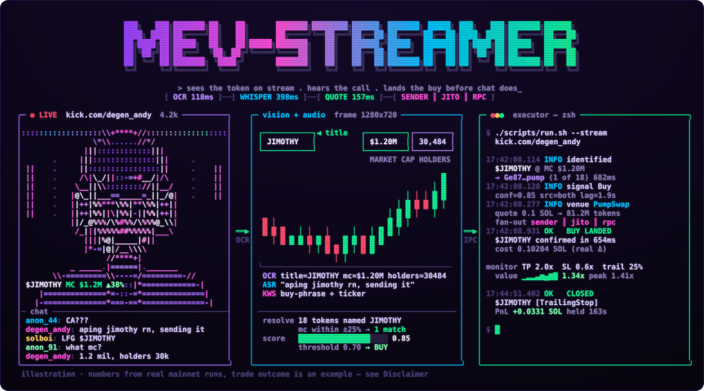</p>

<p align="center">
  
  
  
  
  
</p>

<p align="center">
  <b><a href="#01--quick-start">[ start ]</a></b> ·
  <b><a href="#02--how-it-works">[ pipeline ]</a></b> ·
  <b><a href="#03--signal">[ signal ]</a></b> ·
  <b><a href="#04--no-address">[ no CA ]</a></b> ·
  <b><a href="#05--latency">[ latency ]</a></b> ·
  <b><a href="#06--pump-venues">[ venues ]</a></b> ·
  <b><a href="#07--risk">[ risk ]</a></b> ·
  <b><a href="#08--config">[ config ]</a></b> ·
  <b><a href="#09--internals">[ internals ]</a></b> ·
  <b><a href="#10--limits">[ limits ]</a></b>
</p>

<p align="center"></p>

**The streamer opens a token — the bot is already in.** Python watches the stream and listens to the voice: frame OCR, Whisper, scoring. The Rust executor quotes the pump.fun bonding curve or the PumpSwap pool in a single RPC round trip, signs one transaction and fans it out to Helius Sender, Jito and RPC at once. Then TP / SL / trailing / timeout on the position's real value, and a journal that survives restarts.

<p align="center">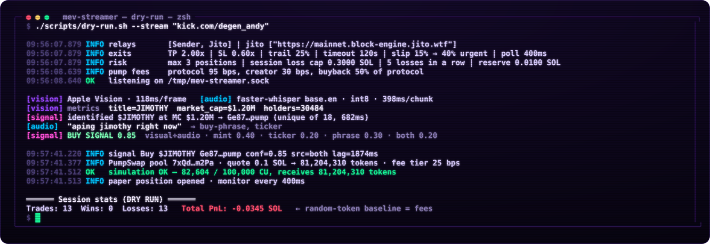</p>

<sub>The terminal is assembled from real mainnet dry-run log lines (OCR, Whisper, CU, the $JIMOTHY identification and the session result are measured). The trade on the cover is an example.</sub>

<p align="center"></p>

<a id="01--quick-start"></a>
<p align="center">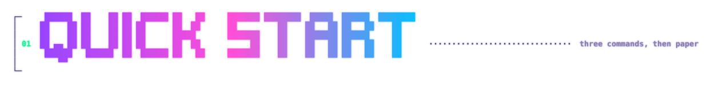</p>

Requires Python 3.11+ (3.13 preferred), Rust, `ffmpeg`.

```bash
./scripts/build.sh            # .venv, dependencies, cargo build --release, .env
$EDITOR .env                  # RPC_URL, STREAM_URL; WALLET_PRIVATE_KEY for live only
./scripts/check.sh            # 43 rust tests, 56 unit checks, smoke — no stream or GPU needed
```

Three modes, in increasing order of risk:

```bash
./scripts/monitor.sh --stream "kick.com/name"   # signals only, nothing is sent
./scripts/dry-run.sh --stream "kick.com/name"   # real tx simulated on mainnet, paper position
./scripts/run.sh     --stream "kick.com/name"   # live: DRY_RUN=false, a key, and typing LIVE
```

Before the first live run:

```bash
X=executor/target/release/mev-streamer-executor
$X --new-wallet ~/mevs-key.txt      # a dedicated hot wallet
$X --selfcheck     <curve MINT>     # buy + full exit vs mainnet simulation, to the lamport
$X --selfcheck-amm <pool MINT>      # same for PumpSwap
$X --probe-relays                   # do relays accept the format? spends nothing
```

> [!IMPORTANT]
> Paper first. Baseline — random fresh tokens, exit on timeout: **13 trades, 0 wins, −2.65%**, which is exactly the fees. The stream signal has to beat ~2.5% per round trip or there is no edge. Paper trades are logged to `logs/trades.dry.jsonl`.

<p align="center"></p>

<a id="02--how-it-works"></a>
<p align="center">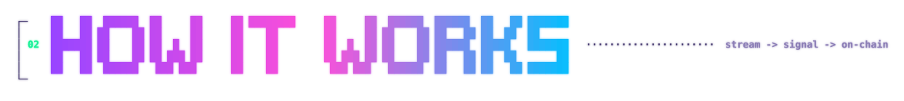</p>

<p align="center">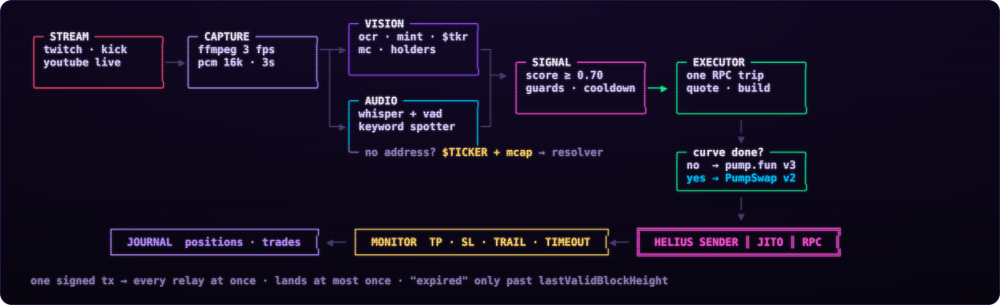</p>

| phase | module | what happens |
|:---:|---|---|
| `1` | **capture** | `streamlink`/`yt-dlp` → two `ffmpeg` processes: 1280×720 frames @ 3 fps and 16 kHz PCM in 3 s chunks. Backoff 1→30 s, a watchdog kills a stalled HLS after 15 s. Always the freshest frame — latency never piles up |
| `2` | **vision** | Apple Vision (ANE) or EasyOCR → mint, `$TICKER`, platform, streamer action, market cap / liquidity / holders. A mint mangled by OCR (`1→I`, `2→Z`, `o→0`) is repaired and verified with one `getMultipleAccounts` |
| `3` | **audio** | faster-whisper + VAD, a keyword spotter catches buy/sell phrases and tickers |
| `4` | **signal** | windows of 3 s (vision) / 10 s (audio), scoring, per-token cooldown. Mint must be seen in ≥ 2 frames; several different mints on screen (chat overlay) → no BUY |
| `5` | **quote** | one round trip: curve + mint + canonical pool + vaults ‖ priority fee ‖ blockhash ‖ balance. Live curve → v3, migrated → PumpSwap v2 |
| `6` | **land** | one signature to every relay — executes at most once. "Not landed" only once block height passes `lastValidBlockHeight`, never on a timer |
| `7` | **manage** | cost basis is the real balance delta of the tx. Exit on position value (what selling everything returns now, after fees); exit slippage escalates up to `EXIT_SLIPPAGE_PCT`; the ATA is closed (≈0.002 SOL rent back) |
| `8` | **journal** | `logs/positions.json` written atomically + `logs/trades.jsonl`. On restart — reconciled against on-chain balances |

<p align="center"></p>

<a id="03--signal"></a>
<p align="center">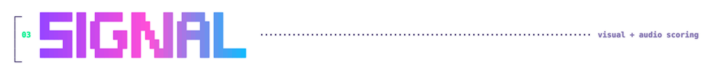</p>

<p align="center">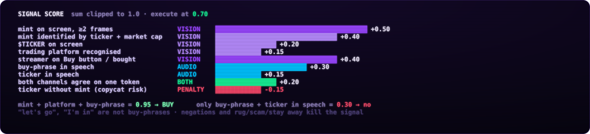</p>

The mint weight is multiplied by 0.8–1.0 based on OCR confidence (a repaired mint is capped at 0.9). Streamer confirmations — "viewing the token" +0.10, "on the Buy button" +0.30, "bought" +0.40. Ticker-only signals without a mint are not sent by default (`ALLOW_TICKER_ONLY=false`).

<p align="center"></p>

<a id="04--no-address"></a>
<p align="center"></p>

Streamers rarely show the CA — usually it's the token page: name, chart, market cap. Memecoin tickers are not unique (dozens of copies), but **ticker + market cap** almost always is.

```
 frame ─┬─▶ $JIMOTHY  (or the big page title)
        └─▶ MARKET CAP $1.2M · HOLDERS 30,484       ← vision/metrics.py, ATH and volume ignored
                    │
                    ▼
 DexScreener: 18 tokens named JIMOTHY ──▶ whose current MC is within ±25% of the on-screen one?
                    │
          exactly one ──▶ Ge87…pump, weight 0.40        several / none ──▶ no buy
```

On a live stream: `identified $JIMOTHY at MC $1.20M → Ge87…pump (unique of 18, 682ms)`.

<p align="center"></p>

<a id="05--latency"></a>
<p align="center">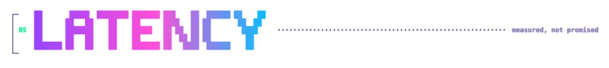</p>

<p align="center">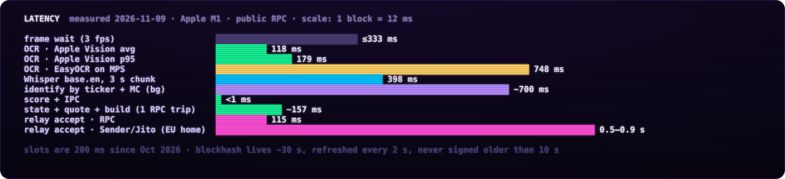</p>

On a CPU without Apple Vision, EasyOCR takes 7–9 s per frame — use Tesseract or `STREAM_FPS=1` there. Your own RPC and a nearby relay matter more than hardware: the executor spends almost all its time waiting on the network. The stream platform's own delay (seconds) cannot be beaten.

<p align="center"></p>

<a id="06--pump-venues"></a>
<p align="center">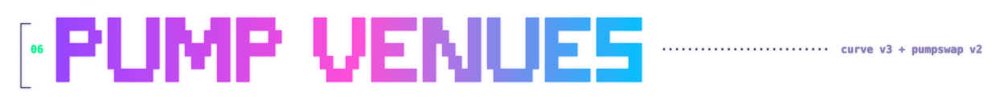</p>

Source of truth — [pump-fun/pump-public-docs](https://github.com/pump-fun/pump-public-docs), IDL of 2026-10-13. Quotes are a port of the reference math in `pump-rust-client` (MIT).

| | bonding curve | PumpSwap |
|---|---|---|
| instructions | `buy_exact_quote_in_v3` / `sell_v3`, 17 accounts | `buy_exact_quote_in_v2` / `sell_v2`, wrap → trade → unwrap in one tx |
| fees | pump-fees `FeeConfig`, only the buyback share paid in-trade | LP / protocol / creator by market-cap tier |
| verified | `--selfcheck`: buy to the token, full exit to the lamport (3 mayhem coins) | `--selfcheck-amm`: buy and exit to the lamport (3 pools) |
| compute | buy 70–75k CU, sell 46k | buy 81–84k, round trip 139–143k |
| immediate round trip | −2.5% | −0.6…−2% |

A curve position that graduates while held moves to the pool automatically. Mayhem coins are supported.

**Rejected with a clear reason:** non-SOL curves, cashback coins and cashback pools, non-wSOL pools, buys that cross the rest of the curve, sells larger than the real reserves. Every non-SOL curve seen on mainnet ended in xStocks (`Xs…`, Token-2022) with no pump route from SOL, so multi-hop is deferred; `--inspect <MINT>` shows the chain.

<p align="center"></p>

<a id="07--risk"></a>
<p align="center">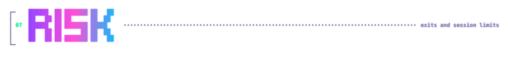</p>

<p align="center">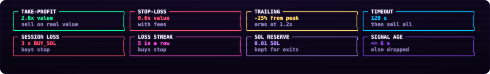</p>

- **landing reconcile** — a tx that lands after a "timeout" never turns into untracked tokens and a second buy;
- **single instance** — a second executor on the same socket refuses to start (bind happens before the journal is opened);
- **honest paper** — a paper position re-applies our own buy to the curve / pool, otherwise exits would be priced against someone else's reserves.

<p align="center"></p>

<a id="08--config"></a>
<p align="center">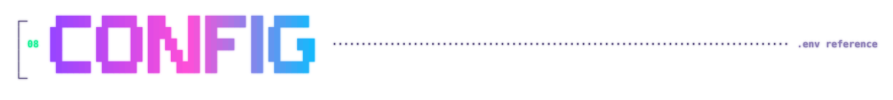</p>

Every module reads `.env` from the repo root; environment variables override it.

| variable | default | |
|---|:-:|---|
| `RPC_URL` | — | your own / Helius — much faster than public |
| `WALLET_PRIVATE_KEY` | empty | base58; empty → ephemeral key, DRY_RUN only |
| `STREAM_URL` | — | or `--stream` |
| `DRY_RUN` | `true` | |
| `BUY_SOL` | — | entry budget, fees included |
| `TAKE_PROFIT` / `STOP_LOSS` / `TIMEOUT_SEC` | 2.0 / 0.6 / 120 | multiples of position value over cost |
| `TRAILING_STOP` | 0.25 | from peak, arms at 1.2×; 0 = off |
| `SLIPPAGE_PCT` / `EXIT_SLIPPAGE_PCT` | 15 / 40 | entry and TP / ceiling for SL, timeout, retries |
| `MAX_POSITIONS` | 3 | |

<details>
<summary><b>capture · vision · audio · signal</b></summary>

| variable | default | |
|---|:-:|---|
| `STREAM_FPS` / `STREAM_AUDIO_CHUNK_SEC` | 3 / 3 | with Apple Vision FPS can go up to 5 |
| `STREAM_RESOLUTION` | `1280:720` | |
| `CAPTURE_STALL_TIMEOUT_SEC` | 15 | restart ffmpeg when no data arrives |
| `OCR_ENGINE` | `auto` | `applevision` / `easyocr` / `tesseract` |
| `OCR_GPU` / `OCR_MIN_CONFIDENCE` | true / 0.4 | EasyOCR |
| `VISION_ROI_MODE` | `auto` | full frame for Apple Vision, zones for the rest |
| `VISION_MINT_REPAIR` | true | fix OCR errors in mints |
| `UI_DETECTION` | true | platform and action |
| `WHISPER_MODEL` / `WHISPER_DEVICE` | `base.en` / auto | CUDA if present, otherwise CPU int8 |
| `SIGNAL_THRESHOLD` / `SIGNAL_COOLDOWN_SEC` | 0.7 / 60 | |
| `ALLOW_TICKER_ONLY` | false | BUY without a mint on screen — copycat risk |
| `HELIUS_API_KEY` | from `RPC_URL` | mint verification when resolving a ticker |

</details>

<details>
<summary><b>sending · fees · compute</b></summary>

| variable | default | |
|---|:-:|---|
| `RELAYS` | `sender,jito` | `sender`, `jito`, `rpc` |
| `JITO_TIP` / `JITO_TIP_MAX` | `auto` / 0.001 | auto = p75 of Jito `tip_floor`, refreshed every 2 s |
| `JITO_URLS` | global | several regions, comma-separated |
| `SENDER_TIP` / `HELIUS_SENDER_URL` | 0.000005 / `/fast` | ≥ 0.001 → Sender Max, less → `?swqos_only=true` |
| `PRIORITY_FEE` | `auto` | p75 of recent fees on this curve within `[MIN, MAX]` µL/CU |
| `CU_LIMIT_BUY` / `CU_LIMIT_SELL` | 90000 / 60000 | curve |
| `CU_LIMIT_AMM_BUY` / `CU_LIMIT_AMM_SELL` | 100000 / 75000 | PumpSwap |
| `SIM_PAYER` | a system wallet | who to simulate as in DRY_RUN without a key |

</details>

<details>
<summary><b>session limits · journal · ipc</b></summary>

| variable | default | |
|---|:-:|---|
| `MAX_SESSION_LOSS` | 3 × `BUY_SOL` | realized loss → buys stop; 0 = off |
| `MAX_CONSECUTIVE_LOSSES` | 5 | |
| `MIN_SOL_RESERVE` | 0.01 | kept for exits |
| `MAX_SIGNAL_AGE_MS` | 6000 | measured from frame / audio capture |
| `MIN_CONFIDENCE` / `MAX_MCAP_SOL` / `REBUY` | 0 / off / false | |
| `MONITOR_INTERVAL_MS` / `STATE_DIR` | 400 / `logs` | |
| `IPC_SOCKET_PATH` / `SOCKET_PATH` | `/tmp/mev-streamer.sock` | the scripts keep both in sync |

</details>

<p align="center"></p>

<a id="09--internals"></a>
<p align="center">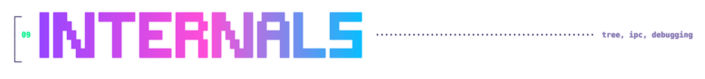</p>

<p align="center">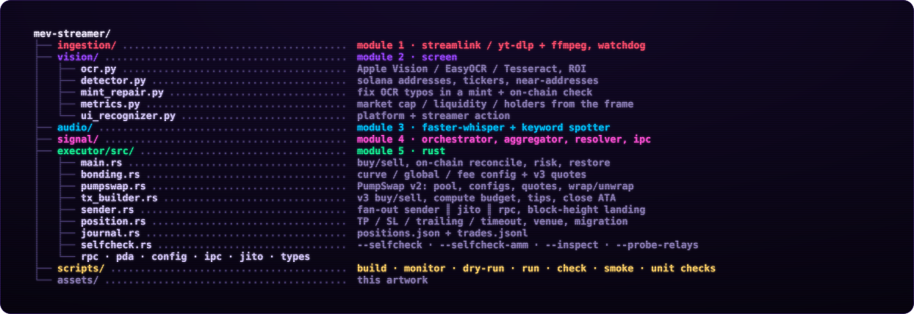</p>

IPC — NDJSON over a Unix socket (mode 0600):

```
→ {"mint":"…pump","ticker":"X","action":"buy","confidence":0.85,"source":"both","context":"…","timestamp":1699999999.1}
← {"status":"ok","bundle_id":"<signature>"}     # "dry-run" in DRY_RUN
← {"status":"error","message":"…"}
```

Debugging and running modules on their own (as scripts, not `python -m` from the root — the `signal/` folder shadows the stdlib):

```bash
./scripts/check.sh --network                       # + smoke test with the real executor
$X --inspect <MINT>                                # where each level of the quote chain trades
.venv/bin/python ingestion/capture.py kick.com/name --seconds 10 --save-frame /tmp/f.png
.venv/bin/python vision/pipeline.py screenshot.png --resize --text --engine applevision
.venv/bin/python audio/pipeline.py --text "aping into PEPE right now"
.venv/bin/python signal/ipc.py --mock
```

The README artwork is generated by `scripts/readme_art.py` (needs `pyfiglet`).

<p align="center"></p>

<a id="10--limits"></a>
<p align="center">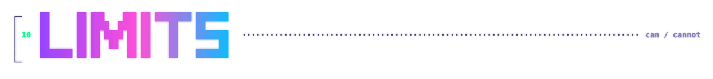</p>

<p align="center">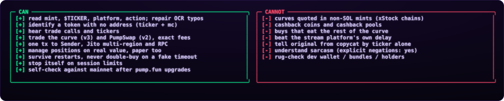</p>

> [!WARNING]
> **Live status.** Transactions are built from the current IDL, buy and full exit match mainnet simulation to the lamport, relays accept the format, journal restore was verified on mainnet with an empty wallet. No real-money trade has been made and strategy profitability is unmeasured — paper first, then the smallest `BUY_SOL`.

> [!CAUTION]
> Experimental project for research and education, not financial advice. Memecoins are extremely volatile, many are scams, and stream signals can be faked specifically to bait bots like this one. Auto-trading on someone else's content may violate platform rules. Only use what you can afford to lose, keep the trading wallet minimal, and never commit `.env`.
