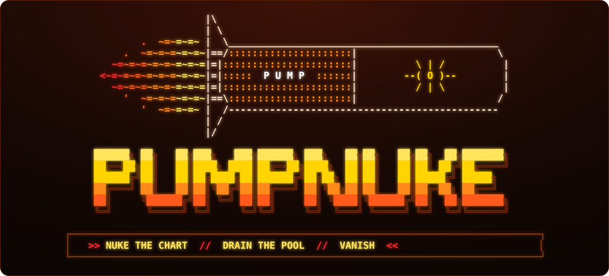
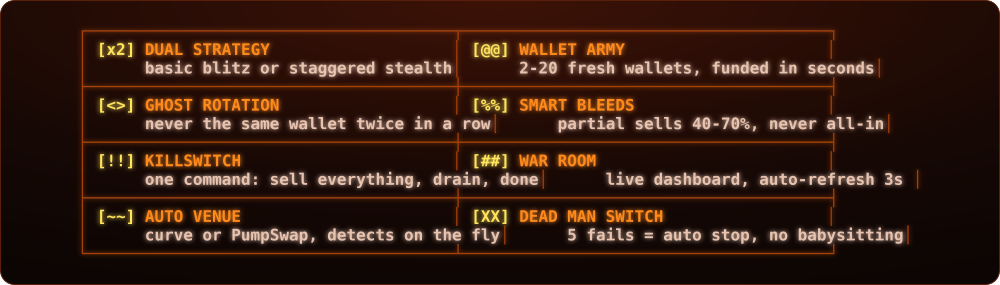
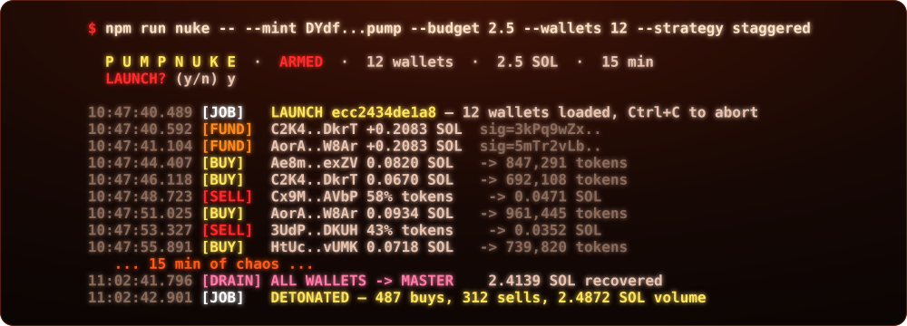
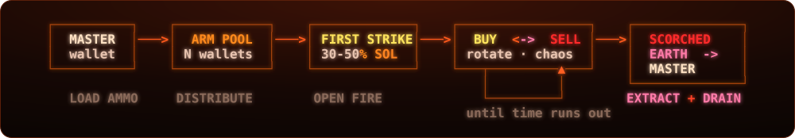
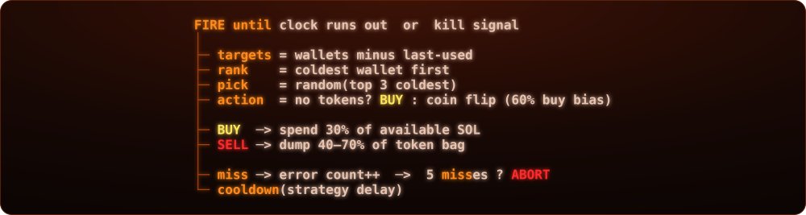
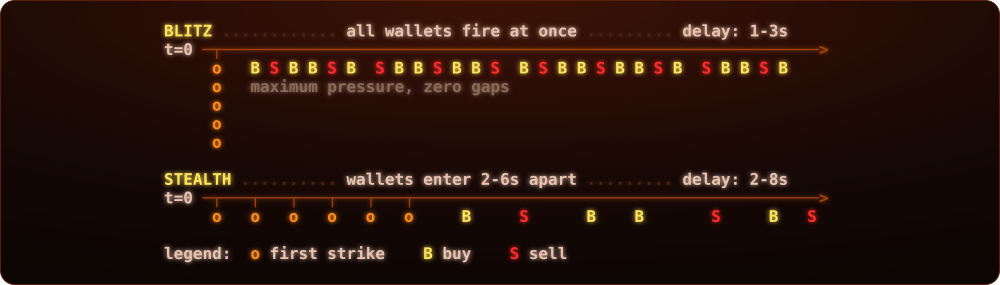
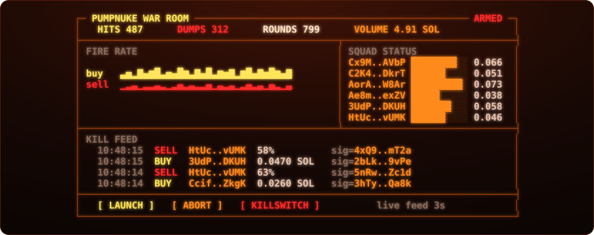
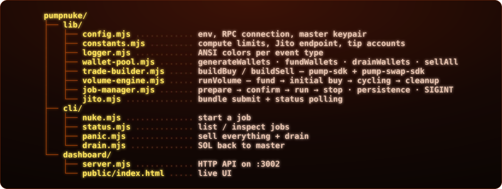
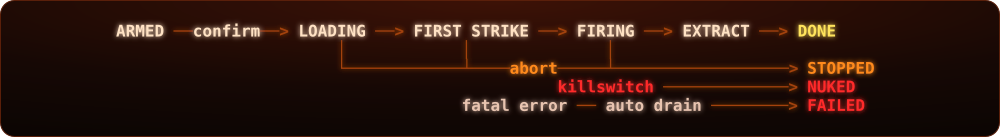
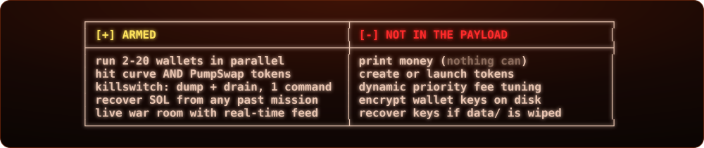

<p align="center"></p>

<p align="center">
  
  
  
  
  
</p>

<p align="center">
  <b><a href="#01--quick-start">[ launch ]</a></b> ·
  <b><a href="#02--how-it-works">[ payload ]</a></b> ·
  <b><a href="#03--strategies">[ tactics ]</a></b> ·
  <b><a href="#04--cli">[ arsenal ]</a></b> ·
  <b><a href="#05--dashboard">[ war room ]</a></b> ·
  <b><a href="#06--configuration">[ warhead ]</a></b> ·
  <b><a href="#07--under-the-hood">[ internals ]</a></b> ·
  <b><a href="#08--faq">[ intel ]</a></b>
</p>

<p align="center"></p>

<p align="center"></p>

**One command. A squad of fresh wallets wakes up. They buy. They sell. They rotate. Nobody uses the same wallet twice in a row.** When the timer hits zero — or you slam `Ctrl+C` — every token gets dumped, every lamport drains back to master. Mission complete.

<p align="center"></p>

<p align="center"></p>

<a id="01--quick-start"></a>
<p align="center"></p>

Three commands. Sixty seconds. You're live.

```bash
git clone https://github.com/zostaff/PUMPNUKE.git && cd PUMPNUKE
npm install
cp .env.example .env
```

Drop your keys:

```env
RPC_URL=https://mainnet.helius-rpc.com/?api-key=YOUR_KEY
WALLET_PRIVATE_KEY=your_base58_private_key
DRY_RUN=false
```

Pull the trigger:

```bash
npm run nuke -- --mint <TOKEN_CA> --budget 2.5 --wallets 12 --strategy staggered
npm run dashboard                # war room -> http://localhost:3002
```

<p align="center"></p>

<a id="02--how-it-works"></a>
<p align="center"></p>

<p align="center"></p>

| phase | codename | what happens |
|:---:|---|---|
| `0` | **load ammo** | master wallet balance verified |
| `1` | **distribute** | SOL split equally across pool, 500ms stagger |
| `2` | **first strike** | 30–50% of each wallet buys in, timed by strategy |
| `3` | **open fire** | rotating buy/sell chaos until timer expires |
| `·` | **extract** | dump all tokens → drain all SOL → master wallet |

<p align="center"></p>

<p align="center"></p>

<a id="03--strategies"></a>
<p align="center"></p>

Pick your weapon. Blitz hits hard and fast. Stealth spreads them out.

<p align="center"></p>

| | `basic` (blitz) | `staggered` (stealth) |
|---|:---:|:---:|
| entry pattern | all wallets at once | 2–6s spacing |
| trade delay | 1–3s | 2–8s |
| pressure | maximum | controlled |
| default | | **yes** |

<p align="center"></p>

<a id="04--cli"></a>
<p align="center"></p>

<p align="center"></p>

| flag | what it does | default |
|---|---|:---:|
| `-m, --mint` | target token address | **required** |
| `-b, --budget` | total SOL to deploy | `0.5` |
| `-w, --wallets` | squad size | `8` |
| `-s, --strategy` | `basic` or `staggered` | `staggered` |
| `-d, --duration` | mission length, minutes | `15` |
| `--bias` | buy probability `0–1` | `0.6` |
| `--slippage` | slippage tolerance, bps | `1000` |
| `-y, --yes` | skip confirmation, go loud | `false` |

```bash
npm run nuke -- --mint <CA> --budget 1.0     # launch
npm run status                                # recon
npm run panic -- <jobId>                      # killswitch
npm run drain -- <jobId>                      # extract SOL
npm run dashboard                             # war room
```

<p align="center"></p>

<a id="05--dashboard"></a>
<p align="center"></p>

Real-time war room. Every buy, every sell, every wallet — right there.

<p align="center"></p>

| method | endpoint | action |
|:---:|---|---|
| `GET` | `/api/jobs` | list all missions |
| `GET` | `/api/jobs/:id` | full intel: keys, last 50 trades |
| `POST` | `/api/jobs` | arm + launch a new mission |
| `POST` | `/api/jobs/:id/stop` | graceful abort |
| `POST` | `/api/jobs/:id/panic` | killswitch: dump + drain |

```bash
curl -X POST http://localhost:3002/api/jobs \
  -H 'Content-Type: application/json' \
  -d '{"mint":"<CA>","budget":1.0,"numWallets":10,"strategy":"staggered","durationMin":20}'
```

<p align="center"></p>

<a id="06--configuration"></a>
<p align="center"></p>

Tune the warhead. Every parameter in `.env`.

| variable | what it controls | default |
|---|---|:---:|
| `RPC_URL` | Solana RPC endpoint | public mainnet |
| `WALLET_PRIVATE_KEY` | master wallet, base58 | — |
| `DRY_RUN` | `false` = live fire | `false` |
| `DEFAULT_STRATEGY` | `basic` / `staggered` | `staggered` |
| `DEFAULT_WALLETS` | squad size | `8` |
| `DEFAULT_BUDGET` | SOL budget | `0.5` |
| `DEFAULT_DURATION_MIN` | mission length | `15` |
| `DEFAULT_BUY_BIAS` | buy probability | `0.6` |
| `DEFAULT_SLIPPAGE_BPS` | slippage tolerance | `1000` |
| `PRIORITY_FEE` | CU price, uLamports | `300000` |
| `JITO_TIP` | Jito tip, SOL | `0.0001` |
| `DASHBOARD_PORT` | war room port | `3002` |
| `SOL_RESERVE` | SOL kept per wallet for fees | `0.01` |

<p align="center"></p>

<a id="07--under-the-hood"></a>
<p align="center"></p>

<p align="center"></p>

<p align="center"></p>

<p align="center"></p>

<p align="center"></p>

<a id="08--faq"></a>
<p align="center"></p>

<details>
<summary><b>> Hit Ctrl+C mid-run?</b></summary>

Scorched earth. All tokens sold, all SOL drained back to master, stats printed. Hit it twice to hard-kill.
</details>

<details>
<summary><b>> Mission stopped by itself?</b></summary>

Dead man switch. Five consecutive failed trades = auto-stop. Dead token, empty curve, or RPC down. Check `npm run status`.
</details>

<details>
<summary><b>> Where are the wallet keys?</b></summary>

`data/jobs/<id>.json`, plaintext, git-ignored. Run `npm run drain -- <id>` to recover SOL from any past mission.
</details>

<details>
<summary><b>> Token graduated mid-run?</b></summary>

Handled. The trade builder detects graduation on every single trade and switches to PumpSwap automatically. Zero downtime.
</details>

<details>
<summary><b>> How many wallets can I run?</b></summary>

2 to 20. More wallets = more rotation = more chaos. Budget is split equally.
</details>

<p align="center"></p>

<p align="center"></p>

<p align="center"></p>

<p align="center"></p>

<p align="center"><sub>built by <a href="https://github.com/zostaff">zostaff</a> — if it works, it works</sub></p>
